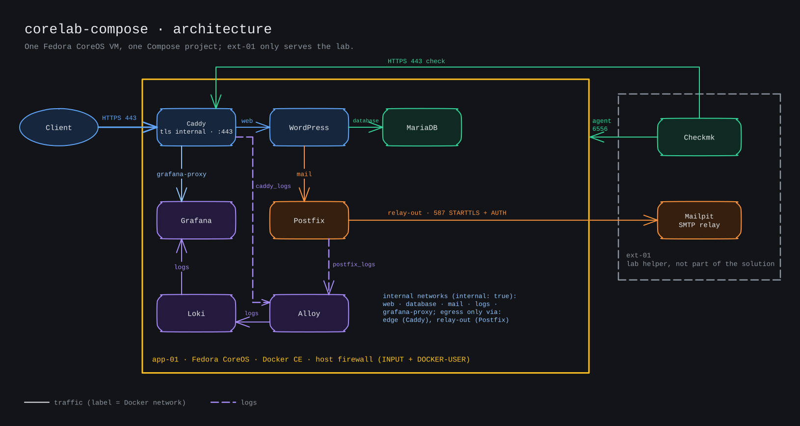

# corelab-compose

[Magyar](README.md) · **English**

[](https://github.com/w7-mgfcode/corelab-compose/actions/workflows/validate.yml)

A **Fedora CoreOS** VM (`app-01`) on Proxmox, running **Docker CE** instead of the built-in Moby, and a single **Docker Compose** project: Caddy (HTTPS issued by an internal CA), WordPress and MariaDB, Postfix (sends through an authenticated external relay), plus Alloy, Loki and Grafana for searchable logs. The host firewall (`INPUT` and `DOCKER-USER`) protects and isolates the services; an external Checkmk monitors it with an agent and an active HTTPS check. Everything is built reproducibly from the repo's files (Butane → Ignition).

## Status

**The configuration is complete and statically checked:** `scripts/validate.sh` processes every file with the pinned tool that uses it (Butane, Compose, Caddy, Loki, Alloy, PHP, Postfix, iptables, shellcheck), and checks the structure and links of the bilingual docs and the cleanliness of the repo; CI runs it on every push. **It has not run on the lab yet.** The lab evidence lives in [docs/en/evidence.md](docs/en/evidence.md); a row becomes "works in the lab" only when its output is recorded there.

## 10-minute tour

1. **[Requirements and solutions](#requirements-and-solutions)** (this README): the 13 points of the task, each with its solution, files, honest status and where the evidence lives.
2. **[`docs/en/architecture.md`](docs/en/architecture.md):** the two diagrams (layout, firewall), the networks, the data paths, the decisions and the limits.
3. **[`compose.yaml`](compose.yaml):** the internal (`internal: true`) networks, `restart: "no"` (only systemd starts the stack, after the firewall) and the file-based secrets.
4. **[`firewall/docker-user.rules`](firewall/docker-user.rules) and [`firewall/corelab-firewall`](firewall/corelab-firewall):** `DOCKER-USER` matches the original destination (`--ctorigdst`); the loader tests first and flushes only afterwards.
5. **[`butane/app-01.bu`](butane/app-01.bu) and [`systemd/corelab-docker-ce.service`](systemd/corelab-docker-ce.service):** the full description of the machine, and the Moby → Docker CE swap on the first boot.
6. **[`docs/en/evidence.md`](docs/en/evidence.md):** per requirement, the command that proves it and where the lab output goes, with the open first-boot questions.
7. **[`scripts/validate.sh`](scripts/validate.sh) and the [CI run](https://github.com/w7-mgfcode/corelab-compose/actions/workflows/validate.yml):** 16 static gates, with pinned tools, on every push.

## Architecture



- Only Caddy publishes a port (TCP 443). Port 80 is closed; there is no HTTP→HTTPS redirect.
- The internal networks (`web`, `database`, `mail`, `logs`, `grafana-proxy`) are `internal: true`: they have no egress. Only Caddy (`edge`) and Postfix (`relay-out`) connect outwards.
- Postfix accepts mail only from the fixed address of WordPress (and the `wpcli` tool) on the `mail` network; everyone else gets a `5.7.1` rejection.
- The logs reach Alloy on shared volumes (Caddy and Postfix write to files), and from there Loki; Grafana is reachable, with a login, as `logs.corelab.test`.

Details (networks, firewall, the Docker CE swap, decisions, limits, next steps): [docs/en/architecture.md](docs/en/architecture.md).

## Requirements and solutions

| # | Requirement | Solution | Files | Status | Evidence |
|---|---|---|---|---|---|
| 1 | Fedora CoreOS under Proxmox | `proxmoxve` qcow2 image, Ignition from the cloud-init `vendor` snippet | `butane/app-01.bu`, `scripts/render-ignition.sh` | statically checked | [1](docs/en/evidence.md#1-fedora-coreos-under-proxmox) |
| 2 | Docker CE (not Moby) | a one-time `rpm-ostree override` swap on the first boot, with a shipped repo file | `systemd/corelab-docker-ce.service`, `butane/docker-ce.repo` | statically checked | [2](docs/en/evidence.md#2-docker-ce-not-the-built-in-moby) |
| 3 | Compose stack on one VM, no cluster | one Compose project, started by systemd after the firewall | `compose.yaml`, `systemd/corelab-stack.service` | statically checked | [3](docs/en/evidence.md#3-compose-stack-on-one-vm-no-cluster) |
| 4 | Web service | WordPress + MariaDB (healthcheck) | `compose.yaml` | statically checked | [4](docs/en/evidence.md#4-web-service-wordpress) |
| 5 | HTTPS-terminating reverse proxy | Caddy, two names, 443 only | `Caddyfile` | statically checked | [5](docs/en/evidence.md#5-https-terminating-reverse-proxy-caddy) |
| 6 | Internal HTTPS, internal CA, automatic certificate issuance | Caddy `tls internal` (local root CA, automatic issuance and renewal) | `Caddyfile`, `docs/en/install.md` | statically checked | [6](docs/en/evidence.md#6-internal-https-with-an-internal-ca-and-automatic-certificate-issuance) |
| 7 | Postfix SMTP container for the services' mail | Debian-based Postfix image; WordPress mu-plugin → Postfix → relay 587, verified TLS + SMTP AUTH | `config/postfix/*`, `config/wordpress/mu-plugins/corelab-smtp.php` | statically checked | [7](docs/en/evidence.md#7-postfix-smtp-container-that-the-services-send-mail-through) |
| 8 | Searchable mail and web logs | Alloy → Loki → Grafana; search by queue ID and HTTP error | `config/alloy`, `config/loki`, `config/grafana` | statically checked | [8](docs/en/evidence.md#8-searchable-mail-and-web-server-logs) |
| 9 | Integration with a central, independent Checkmk | shell agent with a systemd socket (6556) + local check; active HTTPS check | `systemd/check-mk-agent*`, `monitoring/local/corelab_compose` | statically checked | [9](docs/en/evidence.md#9-integration-with-a-central-independent-checkmk) |
| 10 | Firewall: protection and isolation | host layer: `INPUT` + `DOCKER-USER` (matched on the original destination); addition: internal Docker networks | `firewall/*`, `systemd/corelab-firewall-*` | statically checked | [10](docs/en/evidence.md#10-firewall-that-protects-and-isolates-the-container-services) |
| 11 | Backup (optional) | `mariadb-dump` + volume archives, 7 copies kept | `scripts/backup.sh`, `docs/en/operations.md` | statically checked; restore not tried | [11](docs/en/evidence.md#11-backup-optional) |
| 12 | Secret management (optional) | Compose file secrets, root 0700 directory, uploaded over SSH, `.ready` gate | `scripts/gen-secrets.sh`, `scripts/push-secrets.sh` | statically checked | [12](docs/en/evidence.md#12-secret-management-optional) |
| 13 | Update strategy (optional) | Zincati maintenance window, `rpm-ostree rollback`, images pinned by digest | `butane/app-01.bu`, `docs/en/operations.md` | statically checked | [13](docs/en/evidence.md#13-update-strategy-optional) |

## Quick start

```bash
cp examples/lab.env.example lab.env && $EDITOR lab.env
scripts/validate.sh
scripts/render-ignition.sh            # → build/app-01.ign
```

The full run (ext-01, Proxmox `qm` commands, first boot, secrets, WordPress, CA export, Checkmk agent, smoke test): [docs/en/install.md](docs/en/install.md). Setting up ext-01: [external/README.en.md](external/README.en.md). Backup, updates, secrets: [docs/en/operations.md](docs/en/operations.md). Script for a live demo: [docs/en/demo.md](docs/en/demo.md).

## Files

| Path | Contents |
|---|---|
| `butane/` | the FCOS config and the Docker CE repo file |
| `systemd/` | units for the Docker CE swap, the two firewall loaders, the stack and the Checkmk agent |
| `firewall/` | `iptables-restore` templates and the `corelab-firewall` loader (POSIX sh) |
| `compose.yaml`, `Caddyfile`, `config/` | the stack; all of `config/` goes into Ignition |
| `monitoring/local/` | Checkmk local check |
| `external/` | ext-01: Mailpit and Checkmk (not part of the solution) |
| `examples/` | samples of the lab values and the secrets (deliberately outside `config/`) |
| `scripts/` | rendering, static validation, secrets, smoke test, backup, image pinning |
| `docs/` | `hu/` and `en/`: architecture, installation, evidence, operations, demo; `diagrams/`: the diagrams (`.excalidraw` source and `.svg`) |
| `.github/` | CI: `scripts/validate.sh` on every push and pull request |

## Versions

Pinned on 2026-11-16; every image by tag + digest (`scripts/images.sh`, `compose.yaml`).

| Component | Version |
|---|---|
| Fedora CoreOS | `stable` stream, Butane spec `fcos 1.7.0`; the exact release is decided at download time |
| Docker CE | from Docker's Fedora repo on the first boot (the version is to be recorded on the lab) |
| Caddy | `caddy:2.11.9` |
| WordPress | `wordpress:7.1.4-php8.4-apache` |
| WP-CLI | `wordpress:cli-2.12.0-php8.4` |
| MariaDB | `mariadb:11.8.9` |
| Postfix base | `debian:trixie-20261104-slim` (Postfix 3.10) |
| Loki | `grafana/loki:3.7.10` |
| Alloy | `grafana/alloy:v1.22.0` |
| Grafana | `grafana/grafana:13.3.1` |
| Mailpit (ext-01) | `axllent/mailpit:v1.33.1` |
| Checkmk Community (ext-01) | `checkmk/check-mk-community:2.5.0p20` |
| Butane (tool) | `quay.io/coreos/butane:v0.29.0` |
| shellcheck (tool) | `koalaman/shellcheck:v0.11.0` |
| PHP CLI (tool) | `php:8.4.27-cli` |
| curl (tool) | `curlimages/curl:8.23.0` |
| httpd / htpasswd (tool) | `httpd:2.4.71-alpine` |
| lychee (tool) | `lycheeverse/lychee:0.24.2` |

## Related repo

[w7-mgfcode/coreos-platform-lab](https://github.com/w7-mgfcode/coreos-platform-lab) is the longer, process-heavy design repo; this repo is the working, minimal solution.

## Licence

MIT, see the [LICENSE](LICENSE) file.
