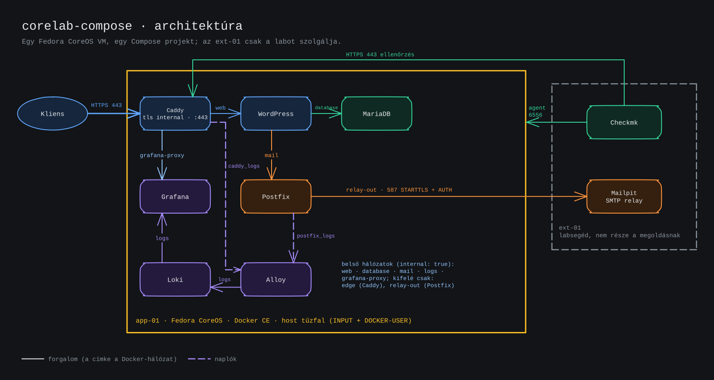

# corelab-compose

**Magyar** · [English](README.en.md)

[](https://github.com/w7-mgfcode/corelab-compose/actions/workflows/validate.yml)

Egy Proxmoxon futó **Fedora CoreOS** VM (`app-01`), rajta a beépített Moby helyett **Docker CE**, és egyetlen **Docker Compose** projekt: Caddy (belső CA-val kiadott HTTPS), WordPress és MariaDB, Postfix (hitelesített külső relayen át küld), valamint Alloy, Loki és Grafana a kereshető naplókhoz. A host tűzfal (`INPUT` és `DOCKER-USER`) védi és elkülöníti a szolgáltatásokat; egy külső Checkmk agenttel és aktív HTTPS-ellenőrzéssel figyeli. Minden a repó fájljaiból, reprodukálhatóan jön létre (Butane → Ignition).

## Állapot

**A konfiguráció teljes, és statikusan ellenőrzött:** a `scripts/validate.sh` minden fájlt azzal a rögzített verziójú eszközzel dolgoz fel, amelyik használja (Butane, Compose, Caddy, Loki, Alloy, PHP, Postfix, iptables, shellcheck), és ellenőrzi a kétnyelvű dokumentáció szerkezetét, hivatkozásait és a repó tisztaságát; minden pushnál a CI is lefuttatja. **A labon még nem futott.** A labos bizonyítékok helye a [docs/hu/evidence.md](docs/hu/evidence.md); egy sor csak akkor kap „működik a labon” állapotot, ha ott a kimenete rögzítve van.

## 10 perces bejárás

1. **[Követelmények és megoldások](#követelmények-és-megoldások)** (ez a README): a feladat 13 pontja, mindegyikhez a megoldás, a fájlok, az őszinte állapot és a bizonyíték helye.
2. **[`docs/hu/architecture.md`](docs/hu/architecture.md):** a két ábra (felépítés, tűzfal), a hálózatok, az adatutak, a döntések és a korlátok.
3. **[`compose.yaml`](compose.yaml):** a belső (`internal: true`) hálózatok, a `restart: "no"` (csak a systemd indít, a tűzfal után) és a fájl alapú secretek.
4. **[`firewall/docker-user.rules`](firewall/docker-user.rules) és [`firewall/corelab-firewall`](firewall/corelab-firewall):** a `DOCKER-USER` az eredeti célcímre szűr (`--ctorigdst`), a betöltő előbb tesztel, csak utána ürít.
5. **[`butane/app-01.bu`](butane/app-01.bu) és [`systemd/corelab-docker-ce.service`](systemd/corelab-docker-ce.service):** a gép teljes leírása, és a Moby → Docker CE csere az első bootkor.
6. **[`docs/hu/evidence.md`](docs/hu/evidence.md):** követelményenként a bizonyító parancs és a labos kimenet helye, az első boot nyitott kérdéseivel.
7. **[`scripts/validate.sh`](scripts/validate.sh) és a [CI-futás](https://github.com/w7-mgfcode/corelab-compose/actions/workflows/validate.yml):** 16 statikus kapu, rögzített verziójú eszközökkel, minden pushnál.

## Architektúra



- Csak a Caddy publikál portot (TCP 443). A 80-as port zárva, HTTP→HTTPS átirányítás nincs.
- A belső hálózatok (`web`, `database`, `mail`, `logs`, `grafana-proxy`) `internal: true`: nincs kimenő forgalmuk. Kifelé csak a Caddy (`edge`) és a Postfix (`relay-out`) kapcsolódik.
- A Postfix csak a WordPress (és a `wpcli` eszköz) fix címéről fogad levelet a `mail` hálózaton; mindenki más `5.7.1` elutasítást kap.
- A naplók megosztott volume-okon jutnak az Alloyhoz (a Caddy és a Postfix fájlba ír), onnan a Lokiba; a Grafana belépéssel érhető el a `logs.corelab.test` néven.

Részletek (hálózatok, tűzfal, Docker CE csere, döntések, korlátok, következő lépések): [docs/hu/architecture.md](docs/hu/architecture.md).

## Követelmények és megoldások

| # | Követelmény | Megoldás | Fájlok | Állapot | Bizonyíték |
|---|---|---|---|---|---|
| 1 | Fedora CoreOS Proxmox alatt | `proxmoxve` qcow2 image, Ignition a cloud-init `vendor` snippetből | `butane/app-01.bu`, `scripts/render-ignition.sh` | statikusan ellenőrzött | [1](docs/hu/evidence.md#1-fedora-coreos-proxmox-alatt) |
| 2 | Docker CE (nem Moby) | első bootkor egyszeri `rpm-ostree override` csere, szállított repófájllal | `systemd/corelab-docker-ce.service`, `butane/docker-ce.repo` | statikusan ellenőrzött | [2](docs/hu/evidence.md#2-docker-ce-nem-a-beépített-moby) |
| 3 | Compose stack egy VM-en, klaszter nélkül | egy Compose projekt, a systemd indítja a tűzfal után | `compose.yaml`, `systemd/corelab-stack.service` | statikusan ellenőrzött | [3](docs/hu/evidence.md#3-compose-stack-egy-vm-en-klaszter-nélkül) |
| 4 | Webes szolgáltatás | WordPress + MariaDB (healthcheck) | `compose.yaml` | statikusan ellenőrzött | [4](docs/hu/evidence.md#4-webes-szolgáltatás-wordpress) |
| 5 | HTTPS-t végződtető reverse proxy | Caddy, két név, csak 443 | `Caddyfile` | statikusan ellenőrzött | [5](docs/hu/evidence.md#5-https-t-végződtető-reverse-proxy-caddy) |
| 6 | Belső HTTPS, belső CA, automatikus tanúsítványkiadás | Caddy `tls internal` (helyi gyökér-CA, automatikus kiadás és megújítás) | `Caddyfile`, `docs/hu/install.md` | statikusan ellenőrzött | [6](docs/hu/evidence.md#6-belső-https-belső-ca-val-és-automatikus-tanúsítványkiadással) |
| 7 | Postfix SMTP konténer a szolgáltatások leveleihez | Debian-alapú Postfix image; WordPress mu-plugin → Postfix → relay 587, ellenőrzött TLS + SMTP AUTH | `config/postfix/*`, `config/wordpress/mu-plugins/corelab-smtp.php` | statikusan ellenőrzött | [7](docs/hu/evidence.md#7-postfix-smtp-konténer-amelyen-át-a-szolgáltatások-levelet-küldenek) |
| 8 | Kereshető levelezési és webnaplók | Alloy → Loki → Grafana; queue ID és HTTP-hiba keresése | `config/alloy`, `config/loki`, `config/grafana` | statikusan ellenőrzött | [8](docs/hu/evidence.md#8-kereshető-levelezési-és-webszerver-naplók) |
| 9 | Bekötés központi, független Checkmk-ba | shell agent systemd sockettel (6556) + local check; aktív HTTPS-ellenőrzés | `systemd/check-mk-agent*`, `monitoring/local/corelab_compose` | statikusan ellenőrzött | [9](docs/hu/evidence.md#9-bekötés-egy-központi-független-checkmk-ba) |
| 10 | Tűzfal: védelem és elkülönítés | host réteg: `INPUT` + `DOCKER-USER` (eredeti célcímre szűrve); kiegészítés: belső Docker-hálózatok | `firewall/*`, `systemd/corelab-firewall-*` | statikusan ellenőrzött | [10](docs/hu/evidence.md#10-tűzfal-amely-védi-és-elkülöníti-a-konténeres-szolgáltatásokat) |
| 11 | Mentés (opcionális) | `mariadb-dump` + volume-archívumok, 7 megőrzött példány | `scripts/backup.sh`, `docs/hu/operations.md` | statikusan ellenőrzött; visszaállítás nincs kipróbálva | [11](docs/hu/evidence.md#11-mentés-opcionális) |
| 12 | Titokkezelés (opcionális) | Compose fájl-secretek, root 0700 könyvtár, SSH-n feltöltve, `.ready` kapu | `scripts/gen-secrets.sh`, `scripts/push-secrets.sh` | statikusan ellenőrzött | [12](docs/hu/evidence.md#12-titokkezelés-opcionális) |
| 13 | Frissítési stratégia (opcionális) | Zincati karbantartási ablak, `rpm-ostree rollback`, digest szerint rögzített image-ek | `butane/app-01.bu`, `docs/hu/operations.md` | statikusan ellenőrzött | [13](docs/hu/evidence.md#13-frissítési-stratégia-opcionális) |

## Gyors kezdés

```bash
cp examples/lab.env.example lab.env && $EDITOR lab.env
scripts/validate.sh
scripts/render-ignition.sh            # → build/app-01.ign
```

A teljes menet (ext-01, Proxmox `qm` parancsok, első boot, titkok, WordPress, CA-export, Checkmk agent, füstteszt): [docs/hu/install.md](docs/hu/install.md). Az ext-01 beállítása: [external/README.md](external/README.md). Mentés, frissítés, titkok: [docs/hu/operations.md](docs/hu/operations.md). Élő bemutató forgatókönyve: [docs/hu/demo.md](docs/hu/demo.md).

## Fájlok

| Hely | Tartalom |
|---|---|
| `butane/` | FCOS konfiguráció és a Docker CE repófájl |
| `systemd/` | a Docker CE csere, a két tűzfal-unit, a stack és a Checkmk agent unitjai |
| `firewall/` | `iptables-restore` sablonok és a `corelab-firewall` betöltő (POSIX sh) |
| `compose.yaml`, `Caddyfile`, `config/` | a stack; a `config/` teljes egészében az Ignitionbe kerül |
| `monitoring/local/` | Checkmk local check |
| `external/` | ext-01: Mailpit és Checkmk (nem része a megoldásnak) |
| `examples/` | a labértékek és a titkok mintája (szándékosan a `config/`-on kívül) |
| `scripts/` | renderelés, statikus ellenőrzés, titkok, füstteszt, mentés, image-rögzítés |
| `docs/` | `hu/` és `en/`: architektúra, telepítés, bizonyítékok, üzemeltetés, bemutató; `diagrams/`: az ábrák (`.excalidraw` forrás és `.svg`) |
| `.github/` | a CI: `scripts/validate.sh` minden pushnál és pull requestnél |

## Verziók

Rögzítve 2026-11-16-án; minden image tag + digest szerint (`scripts/images.sh`, `compose.yaml`).

| Komponens | Verzió |
|---|---|
| Fedora CoreOS | `stable` stream, Butane spec `fcos 1.7.0`; a konkrét kiadás a letöltéskor dől el |
| Docker CE | a Docker Fedora repójából az első bootkor (a verzió a labon rögzítendő) |
| Caddy | `caddy:2.11.9` |
| WordPress | `wordpress:7.1.4-php8.4-apache` |
| WP-CLI | `wordpress:cli-2.12.0-php8.4` |
| MariaDB | `mariadb:11.8.9` |
| Postfix alap | `debian:trixie-20261104-slim` (Postfix 3.10) |
| Loki | `grafana/loki:3.7.10` |
| Alloy | `grafana/alloy:v1.22.0` |
| Grafana | `grafana/grafana:13.3.1` |
| Mailpit (ext-01) | `axllent/mailpit:v1.33.1` |
| Checkmk Community (ext-01) | `checkmk/check-mk-community:2.5.0p20` |
| Butane (eszköz) | `quay.io/coreos/butane:v0.29.0` |
| shellcheck (eszköz) | `koalaman/shellcheck:v0.11.0` |
| PHP CLI (eszköz) | `php:8.4.27-cli` |
| curl (eszköz) | `curlimages/curl:8.23.0` |
| httpd / htpasswd (eszköz) | `httpd:2.4.71-alpine` |
| lychee (eszköz) | `lycheeverse/lychee:0.24.2` |

## Kapcsolódó repó

A [w7-mgfcode/coreos-platform-lab](https://github.com/w7-mgfcode/coreos-platform-lab) a hosszabb, folyamatközpontú tervezési repó; ez a repó a működő, minimális megoldás.

## Licenc

MIT, lásd a [LICENSE](LICENSE) fájlt.
