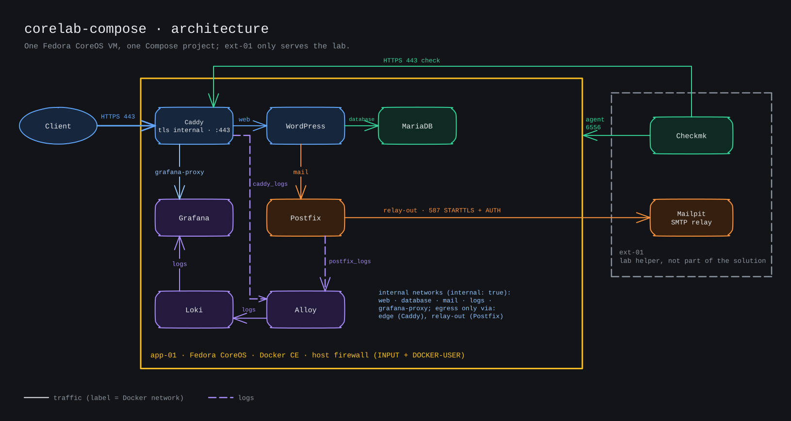
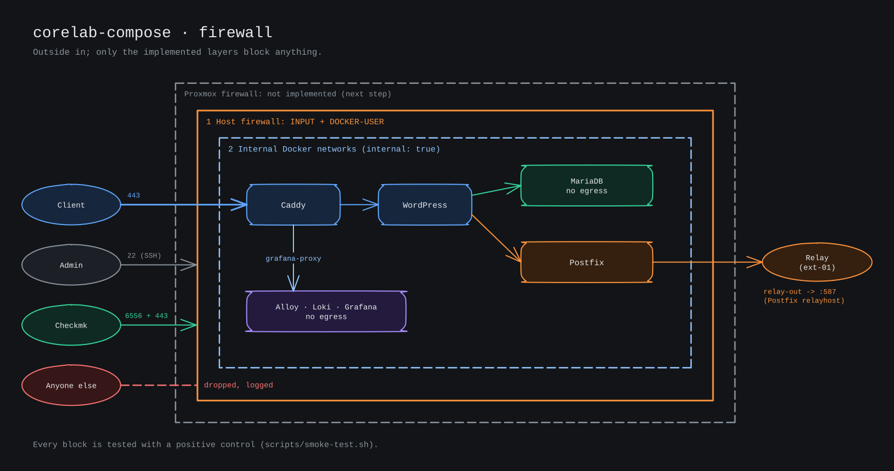

# Architecture

[Magyar](../hu/architecture.md) · **English**

## Overview

A single Fedora CoreOS VM (`app-01`) runs on Proxmox. It runs Docker CE instead of the built-in Moby, and a single Compose project (`corelab`): Caddy terminates HTTPS with the internal CA, WordPress and MariaDB sit behind it, Postfix hands mail to an authenticated external relay, and Alloy ships the Caddy and Postfix logs to Loki, where Grafana makes them searchable. The host firewall (`INPUT` + `DOCKER-USER`) protects the machine, and an external Checkmk monitors it. The second VM (`ext-01`) only serves the lab: it plays the relay (Mailpit) and the central Checkmk, and is not part of the solution. Everything is built reproducibly from the repo's files (Butane → Ignition).

## Components

Source: [`compose.yaml`](../../compose.yaml). Every service runs with `restart: "no"` and `no-new-privileges`; only `corelab-stack.service` starts the stack, after the firewall.

| Service | Role | Networks | Persistent data |
|---|---|---|---|
| `caddy` | HTTPS termination (`tls internal`) and reverse proxy for two names; the only published port (TCP 443) | `edge`, `web`, `grafana-proxy` | `caddy_data` (internal CA, certificates), `caddy_config`, `caddy_logs` |
| `wordpress` | the web service (PHP 8.4, Apache); a mu-plugin hands its mail to Postfix | `web`, `database`, `mail` (`172.30.10.10`) | `wp_html` |
| `mariadb` | the WordPress database, with a healthcheck | `database` | `mariadb_data` |
| `wpcli` | a tool (`tools` profile), not long-running: install, test mail | `database`, `mail` (`172.30.10.11`) | `wp_html` (shared with WordPress) |
| `postfix` | SMTP: accepts mail only from WordPress and `wpcli`, hands all of it to the relay (587, STARTTLS, SMTP AUTH) | `mail`, `relay-out` | `postfix_queue`, `postfix_logs` |
| `alloy` | log shipper: the Caddy and Postfix log files, from read-only mounts, to Loki | `logs` | `alloy_data` (read positions) |
| `loki` | log store, on the local filesystem, with 7-day retention | `logs` | `loki_data` |
| `grafana` | log search (Explore), login required | `logs`, `grafana-proxy` | `grafana_data` |

On ext-01 ([`external/compose.yaml`](../../external/compose.yaml)) run Mailpit (relay, 587, and UI, 8025) and Checkmk Community (UI, 8080).

## Networks

| Docker network | Type | Members |
|---|---|---|
| `edge` | with egress | Caddy (needed to publish 443: Docker does not publish ports on an internal network) |
| `web` | internal | Caddy ↔ WordPress |
| `grafana-proxy` | internal | Caddy ↔ Grafana |
| `database` | internal | WordPress, wpcli ↔ MariaDB |
| `mail` (`172.30.10.0/24`) | internal | WordPress (`.10`), wpcli (`.11`) → Postfix |
| `logs` | internal | Alloy → Loki ← Grafana |
| `relay-out` | with egress | Postfix → relay (ext-01:587) |

The internal (`internal: true`) networks have no egress. Only Caddy (`edge`) and Postfix (`relay-out`) connect outwards.

## Data paths

1. **Web:** client → `https://app.corelab.test` (TCP 443) → Caddy (TLS with the internal CA) → `web` network → WordPress (HTTP 80) → `database` network → MariaDB.
2. **Mail:** WordPress (the `corelab-smtp.php` mu-plugin on the `phpmailer_init` hook) → `mail` network → Postfix:25 → `relay-out` network → `relay.corelab.test:587` on ext-01, with mandatory STARTTLS, verification of the relay's certificate and SMTP AUTH. Postfix accepts mail only from the fixed addresses of WordPress (`.10`) and `wpcli` (`.11`); everyone else gets a `5.7.1` rejection.
3. **Logs:** Caddy writes a JSON access log to the `caddy_logs` volume, Postfix writes through its `postlog` service to the `postfix_logs` volume. Alloy mounts both read-only and sends them to Loki on the `logs` network (labels: `service`, `host`). Grafana is reachable as `logs.corelab.test`, through Caddy, with a login.

## HTTPS and the internal CA

- Caddy runs with `tls internal` for both names (`app.corelab.test`, `logs.corelab.test`): its own local CA issues and renews the certificates automatically, without a separate ACME server ([Caddy: Automatic HTTPS, local HTTPS](https://caddyserver.com/docs/automatic-https#local-https)).
- The CA (root and private key) lives in the `caddy_data` volume, so the backup includes that volume. Only the public `root.crt` leaves the VM.
- Port 80 is not published, and there is no HTTP→HTTPS redirect (`auto_https disable_redirects`).
- HTTP between the proxy and the applications runs only on the internal networks; end-to-end TLS is not part of the solution.
- Exporting the root certificate and trusting it on the client: [install.md, step 9](install.md#9-export-the-internal-ca-and-trust-it-on-the-client). Certificate verification is never turned off; the `hygiene` gate forbids, in the repo, the curl switches that would turn it off.

## Firewall

The host firewall, in plain words ([`firewall/`](../../firewall/)):

- **INPUT (IPv4):** drops by default. Loopback and return traffic are allowed; SSH (22) and ping only from the admin source; the agent (6556) and ping only from the Checkmk address; DHCP replies are allowed; everything else is logged (rate-limited) and dropped.
- **INPUT (IPv6):** closed; only loopback, return traffic and neighbour discovery (NDP).
- **DOCKER-USER:** on the external interface, only the client and the Checkmk sources may reach the published container port, and only if the **original** destination is the VM's port 443. Everything else is dropped. The rules are limited to the external interface, so container egress is not affected.
- **Loading:** `corelab-firewall-host` loads before the network; `corelab-firewall-docker` loads after every Docker start (`PartOf=docker.service`), and only then does the stack start. The containers run with `restart: "no"`, so the Docker daemon cannot start them before the rules. The loader tests every rule set first, and only then flushes the chain.

**Why `--ctorigdst`:** Docker DNATs the traffic for a published port in the `nat` table, so by the time a packet reaches the `DOCKER-USER` chain, its destination address and port are already the container's. The rule therefore matches the **original** destination of the conntrack entry (`-m conntrack --ctorigdst … --ctorigdstport 443`), as the Docker documentation recommends ([Docker: packet filtering and firewalls](https://docs.docker.com/engine/network/packet-filtering-firewalls/#add-iptables-policies-before-dockers-rules)).

**Layers:** the required layer is the host firewall. The internal Docker networks (`internal: true`, see above) add a second layer. The **Proxmox firewall is not implemented**: it is listed under [next steps](#next-steps).

## Docker CE instead of Moby

Fedora CoreOS ships the Moby-based Docker (`moby-engine`); the task asks for Docker CE. `corelab-docker-ce.service` follows the upstream FCOS guide ([Fedora CoreOS: Installing Docker CE](https://github.com/coreos/fedora-coreos-docs/blob/main/modules/ROOT/pages/docker-ce.adoc)):

- it runs once on the first boot, swaps the packages with `rpm-ostree override remove moby-engine containerd runc docker-cli --install docker-ce --install docker-compose-plugin`, and reboots;
- Ignition ships the Docker repo file (`butane/docker-ce.repo`); nothing is downloaded at runtime;
- the other units gate on the result of `rpm -q docker-ce` (the `ExecStartPre` line of `corelab-stack`), not on the stamp file.

**Risk:** the overridden base packages can block a Fedora major upgrade; this did happen at the Fedora 40 → 41 upgrade, because of the new `docker-cli` package. That is why Zincati may reboot only in the Sunday maintenance window (from 03:00 for 60 minutes, UTC), why the Docker repo must be checked for the new release before a major upgrade, and why `rpm-ostree rollback` is the way back if something breaks.

## Secrets, backup, updates

**Secrets:** their source is the workstation; they go neither into the repo nor into Ignition. They reach the VM over SSH, into a root 0700 directory, and Compose hands them as file-based secrets, under `/run/secrets`, only to the services that need them. Without the `.ready` marker file the stack does not start. Details: [operations.md, Secrets](operations.md#secrets).

**Backup:** `scripts/backup.sh` creates a MariaDB dump and volume archives (`wp_html`, `caddy_data`, `grafana_data`) on the VM and keeps 7 copies. The restore is described but not tried. Details: [operations.md, Backup](operations.md#backup).

**Updates:** Zincati updates the host in the maintenance window, with `rpm-ostree rollback` as the way back; container images are pinned by tag + digest, so nothing updates by itself. Details: [operations.md, Updates](operations.md#updates).

## Decisions and rejected alternatives

- **Docker Compose on one VM, no Swarm:** the task asks for one VM; Swarm without a cluster would only add complexity. Rejected.
- **Docker CE instead of the built-in Moby:** the task explicitly asks for Docker CE; the risk of the swap and how it is handled are described above.
- **Logs on shared volumes**, not through the journal: the containers do not need to read the host journal (an SELinux question), and no `daemon.json` is needed. Journal-based collection was therefore rejected.
- **The WordPress code (`wp_html`) is a volume**, so `wpcli` sees the same installation.
- **Secrets as 0444 files in a root 0700 directory:** the containers read them with different UIDs; on the host only root can reach them.
- **Two small firewall units**, before and after Docker; containers start only through systemd.
- **The relay is Mailpit on a separate VM (ext-01)**, not on app-01: this way outbound TLS verification, SMTP AUTH and the `relay-out` network are visible in real operation.
- **Checkmk:** the free edition is now called *Checkmk Community* (formerly Checkmk Raw). Agent: the official shell script without a package, with a systemd socket, because `/usr` is read-only, and a second layered package next to Docker CE would be an update risk.

## Limits

- **One VM, one point of failure.** Losing the VM, its storage or the Proxmox host is an outage; this is not an HA system.
- **ext-01 is not hardened**, and Mailpit is only a test receiver: it proves delivery inside the lab, not delivery on the internet.
- **The legacy Checkmk agent connection is unencrypted** (6556); the firewall allows it only from the Checkmk address.
- **The secrets are not encrypted on the host**; root or Docker API access can read them. There is no automatic rotation.
- **WordPress cannot reach the internet** (it sits only on internal networks): no plugin installs or core updates from the UI at runtime.
- **A short rule-less moment:** between flushing a chain and loading it, the firewall loader leaves the chain empty for less than a second. At boot this is acceptable, because no container is running yet.
- **IPv6 is closed**; the stack serves IPv4 only.
- **iptables-nft `--test` does not check jump targets**, so the static gate actually loads the filled-in rules in a throwaway container's own network namespace.

## Next steps

- The Proxmox firewall as a third layer (VM-level rules), with its own negative tests.
- Egress filtering in `DOCKER-USER`: Postfix only to the relay's port 587, all other bridge traffic dropped.
- An encrypted agent connection (Checkmk agent controller, with TLS registration).
- An encrypted backup off the VM, with a timed restore test.
