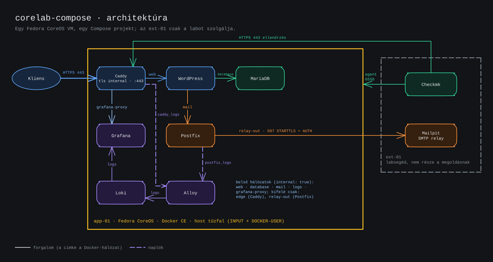
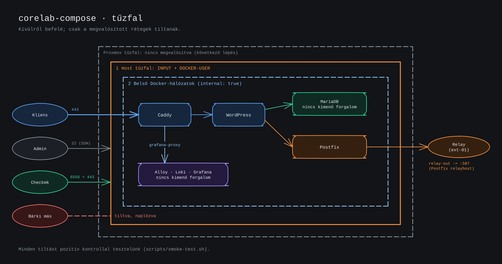

# Architektúra

**Magyar** · [English](../en/architecture.md)

## Áttekintés

Egyetlen Fedora CoreOS VM (`app-01`) fut a Proxmoxon. Rajta a beépített Moby helyett Docker CE, és egyetlen Compose projekt (`corelab`): Caddy végződteti a HTTPS-t a belső CA-val, mögötte WordPress és MariaDB, a leveleket Postfix adja tovább egy hitelesített külső relaynek, a Caddy és a Postfix naplóit pedig Alloy gyűjti a Lokiba, ahol Grafanával kereshetők. A gépet a host tűzfal (`INPUT` + `DOCKER-USER`) védi, és egy külső Checkmk figyeli. A második VM (`ext-01`) csak a labot szolgálja: a relayt (Mailpit) és a központi Checkmk-ot játssza, nem része a megoldásnak. Minden a repó fájljaiból, reprodukálhatóan jön létre (Butane → Ignition).

## Komponensek

Forrás: [`compose.yaml`](../../compose.yaml). Minden szolgáltatás `restart: "no"` és `no-new-privileges` beállítással fut; a stacket csak a `corelab-stack.service` indítja, a tűzfal után.

| Szolgáltatás | Feladat | Hálózatok | Tartós adat |
|---|---|---|---|
| `caddy` | HTTPS-végződtetés (`tls internal`) és reverse proxy két névre; az egyetlen publikált port (TCP 443) | `edge`, `web`, `grafana-proxy` | `caddy_data` (belső CA, tanúsítványok), `caddy_config`, `caddy_logs` |
| `wordpress` | a webes szolgáltatás (PHP 8.4, Apache); a leveleket egy mu-plugin a Postfixnek adja | `web`, `database`, `mail` (`172.30.10.10`) | `wp_html` |
| `mariadb` | a WordPress adatbázisa, healthcheckkel | `database` | `mariadb_data` |
| `wpcli` | eszköz (`tools` profil), nem fut tartósan: telepítés, tesztlevél | `database`, `mail` (`172.30.10.11`) | `wp_html` (közös a WordPress-szel) |
| `postfix` | SMTP: csak a WordPress és a `wpcli` leveleit fogadja, mindet a relaynek adja (587, STARTTLS, SMTP AUTH) | `mail`, `relay-out` | `postfix_queue`, `postfix_logs` |
| `alloy` | naplógyűjtő: a Caddy és a Postfix naplófájljai csak olvasható csatolásról a Lokiba | `logs` | `alloy_data` (olvasási pozíciók) |
| `loki` | naplótár, helyi fájlrendszeren, 7 nap megőrzéssel | `logs` | `loki_data` |
| `grafana` | naplókeresés (Explore), csak belépéssel | `logs`, `grafana-proxy` | `grafana_data` |

Az ext-01-en ([`external/compose.yaml`](../../external/compose.yaml)) a Mailpit (relay, 587 és UI 8025) és a Checkmk Community (UI 8080) fut.

## Hálózatok

| Docker-hálózat | Típus | Résztvevők |
|---|---|---|
| `edge` | kimenő is | Caddy (a 443 publikálásához kell: belső hálózaton a Docker nem publikál portot) |
| `web` | belső | Caddy ↔ WordPress |
| `grafana-proxy` | belső | Caddy ↔ Grafana |
| `database` | belső | WordPress, wpcli ↔ MariaDB |
| `mail` (`172.30.10.0/24`) | belső | WordPress (`.10`), wpcli (`.11`) → Postfix |
| `logs` | belső | Alloy → Loki ← Grafana |
| `relay-out` | kimenő is | Postfix → relay (ext-01:587) |

A belső (`internal: true`) hálózatoknak nincs kimenő forgalmuk. Kifelé csak a Caddy (`edge`) és a Postfix (`relay-out`) kapcsolódik.

## Adatutak

1. **Web:** kliens → `https://app.corelab.test` (TCP 443) → Caddy (TLS a belső CA-val) → `web` hálózat → WordPress (HTTP 80) → `database` hálózat → MariaDB.
2. **Levél:** WordPress (a `corelab-smtp.php` mu-plugin a `phpmailer_init` hookon) → `mail` hálózat → Postfix:25 → `relay-out` hálózat → `relay.corelab.test:587` az ext-01-en, kötelező STARTTLS-sel, a relay tanúsítványának ellenőrzésével és SMTP AUTH-tal. A Postfix csak a WordPress (`.10`) és a `wpcli` (`.11`) fix címéről fogad levelet; mindenki más `5.7.1` elutasítást kap.
3. **Naplók:** a Caddy JSON access logot ír a `caddy_logs` volume-ra, a Postfix a `postlog` szolgáltatáson át a `postfix_logs` volume-ra. Az Alloy mindkettőt csak olvashatóan csatolja, és a `logs` hálózaton a Lokiba küldi (címkék: `service`, `host`). A Grafana a `logs.corelab.test` néven, a Caddyn át, belépéssel érhető el.

## HTTPS és belső CA

- A Caddy mindkét névnél (`app.corelab.test`, `logs.corelab.test`) `tls internal` beállítással fut: a saját helyi CA-ja automatikusan kiadja és megújítja a tanúsítványokat, külön ACME-szerver nélkül ([Caddy: Automatic HTTPS, local HTTPS](https://caddyserver.com/docs/automatic-https#local-https)).
- A CA (gyökér és privát kulcs) a `caddy_data` volume-ban él; a mentés ezért ezt a volume-ot is menti. A VM-et csak a nyilvános `root.crt` hagyja el.
- A 80-as port nincs publikálva, és nincs HTTP→HTTPS átirányítás (`auto_https disable_redirects`).
- A proxy és az alkalmazások közötti HTTP csak a belső hálózatokon fut; végpontok közötti TLS nem része a megoldásnak.
- A gyökértanúsítvány exportja és a kliens bizalma: [install.md, 9. lépés](install.md#9-a-belső-ca-exportja-és-a-kliens-bizalma). A tanúsítvány-ellenőrzést soha nem kapcsoljuk ki; a `hygiene` kapu a repóban tiltja az ellenőrzést kikapcsoló curl-kapcsolókat.

## Tűzfal

Host tűzfal, egyszerű szavakkal ([`firewall/`](../../firewall/)):

- **INPUT (IPv4):** alapból eldob. Loopback és visszirányú forgalom engedett; SSH (22) és ping csak az admin forrásról; agent (6556) és ping csak a Checkmk címéről; DHCP-válaszok engedettek; a többi naplózva (korlátozott ütemben) eldobva.
- **INPUT (IPv6):** zárva, csak loopback, visszirány és szomszédfelderítés (NDP).
- **DOCKER-USER:** a külső interfészen a publikált konténerportot csak a kliens- és a Checkmk-forrás érheti el, és csak akkor, ha az **eredeti** cél a VM 443-as portja. Minden más eldobva. A szabályok a külső interfészre szűkítettek, így a konténerek kimenő forgalma nem esik bele.
- **Betöltés:** a `corelab-firewall-host` a hálózat előtt tölt; a `corelab-firewall-docker` minden Docker-indítás után (`PartOf=docker.service`), és a stack csak utána indul. A konténerek `restart: "no"` beállítással futnak, hogy a Docker démon ne indíthassa őket a szabályok előtt. A betöltő minden szabálykészletet előbb tesztel, és csak utána üríti a láncot.

**Miért `--ctorigdst`:** a publikált port forgalmát a Docker a `nat` táblában DNAT-olja, így mire a csomag a `DOCKER-USER` láncba ér, a célcím és a célport már a konténeré. A szabály ezért a conntrack bejegyzés **eredeti** célját vizsgálja (`-m conntrack --ctorigdst … --ctorigdstport 443`), ahogy a Docker dokumentációja javasolja ([Docker: packet filtering and firewalls](https://docs.docker.com/engine/network/packet-filtering-firewalls/#add-iptables-policies-before-dockers-rules)).

**Rétegek:** a kötelező réteg a host tűzfal. Kiegészítés a belső Docker-hálózatok rétege (`internal: true`, lásd fent). A **Proxmox tűzfal nincs megvalósítva**: a [következő lépések](#következő-lépések) között szerepel.

## Docker CE a Moby helyett

A Fedora CoreOS gyárilag a Moby-alapú Dockert (`moby-engine`) tartalmazza; a feladat Docker CE-t kér. A `corelab-docker-ce.service` az upstream FCOS leírás ([Fedora CoreOS: Installing Docker CE](https://github.com/coreos/fedora-coreos-docs/blob/main/modules/ROOT/pages/docker-ce.adoc)) mintáját követi:

- az első bootkor egyszer lefut, és `rpm-ostree override remove moby-engine containerd runc docker-cli --install docker-ce --install docker-compose-plugin` paranccsal lecseréli a csomagokat, majd újraindít;
- a Docker repófájlt (`butane/docker-ce.repo`) az Ignition szállítja, nem futásidőben töltődik le;
- a többi unit a `rpm -q docker-ce` eredményére kapuz (a `corelab-stack` `ExecStartPre` sora), nem a stampfájlra.

**Kockázat:** a felülírt alapcsomagok miatt egy Fedora főverzió-váltás elakadhat; a Fedora 40 → 41 váltásnál ez meg is történt az új `docker-cli` csomag miatt. Ezért a Zincati csak a vasárnapi karbantartási ablakban (03:00-tól 60 percig, UTC) indíthat újra, egy főverzió-váltás előtt ellenőrizni kell, hogy a Docker repó támogatja-e az új kiadást, és hiba esetén `rpm-ostree rollback` a visszaút.

## Titkok, mentés, frissítés

**Titkok:** a forrásuk a munkaállomás; sem a repóba, sem az Ignitionbe nem kerülnek. SSH-n jutnak a VM-re egy root 0700 könyvtárba, és a Compose fájl alapú secretként, `/run/secrets` alatt adja őket csak azoknak a szolgáltatásoknak, amelyeknek kellenek. A `.ready` jelzőfájl nélkül a stack nem indul. Részletek: [operations.md, Titkok](operations.md#titkok).

**Mentés:** a `scripts/backup.sh` a VM-en MariaDB-dumpot és volume-archívumokat (`wp_html`, `caddy_data`, `grafana_data`) készít, 7 példányt megőrizve. A visszaállítás leírva, de nincs kipróbálva. Részletek: [operations.md, Mentés](operations.md#mentés).

**Frissítés:** a host frissítését a Zincati végzi a karbantartási ablakban, `rpm-ostree rollback` visszaúttal; a konténerképek tag + digest szerint rögzítettek, így semmi sem frissül magától. Részletek: [operations.md, Frissítés](operations.md#frissítés).

## Döntések és elvetett alternatívák

- **Docker Compose egy VM-en, Swarm nélkül:** a feladat egy VM-et kér; a Swarm klaszter nélkül csak bonyolultságot adna. Elvetve.
- **Docker CE a beépített Moby helyett:** a feladat kifejezetten Docker CE-t kér; a csere kockázatát és kezelését lásd fent.
- **Naplók megosztott volume-okon**, nem a journalon át: így nem kell a konténereknek a host journalját olvasniuk (SELinux-kérdés), és nincs szükség `daemon.json`-ra. A journal alapú gyűjtés ezért elvetve.
- **A WordPress kódja (`wp_html`) volume**, így a `wpcli` ugyanazt a telepítést látja.
- **Titkok 0444-es fájlként egy root 0700 könyvtárban:** a konténerek eltérő UID-dal olvasnak; a hoston csak root fér hozzá.
- **Két kis tűzfal-unit** a Docker előtt és után, a konténerek indítása csak a systemd-n át.
- **A relay a Mailpit egy külön VM-en (ext-01)**, nem az app-01-en: így a kimenő TLS-ellenőrzés, az SMTP AUTH és a `relay-out` hálózat ténylegesen működés közben látszik.
- **Checkmk:** az ingyenes kiadás ma *Checkmk Community* néven fut (korábban: Checkmk Raw). Agent: a hivatalos shell script csomag nélkül, systemd sockettel, mert a `/usr` csak olvasható, és egy második rétegzett csomag a Docker CE mellett frissítési kockázat lenne.

## Korlátok

- **Egy VM, egy hibapont.** A VM, a tárolója és a Proxmox host kiesése szolgáltatáskiesés; ez nem HA-rendszer.
- **Az ext-01 nem hardenelt**, és a Mailpit csak tesztfogadó: a labon belüli kézbesítést bizonyítja, nem internetes kézbesítést.
- **A legacy Checkmk agent kapcsolata titkosítatlan** (6556); a tűzfal csak a Checkmk címéről engedi.
- **A titkok nincsenek titkosítva a hoston**; root vagy Docker API hozzáféréssel olvashatók. Nincs automatikus rotáció.
- **A WordPress nem éri el az internetet** (csak belső hálózatokon van): futás közben nincs plugin-telepítés vagy core-frissítés a felületről.
- **Rövid szabálymentes pillanat:** a tűzfal betöltő a lánc ürítése és a betöltés között egy másodpercnél rövidebb ideig üres láncot hagy. Bootkor ez elfogadható, mert ekkor még nem fut konténer.
- **Az IPv6 zárva van**; a stack csak IPv4-en szolgál ki.
- **Az iptables-nft `--test` módja nem ellenőrzi az ugráscélokat**, ezért a statikus kapu a kitöltött szabályokat egy eldobható konténer saját hálózati névterében ténylegesen betölti.

## Következő lépések

- Proxmox tűzfal mint harmadik réteg (VM-szintű szabályok), saját negatív tesztekkel.
- Kimenő szűrés a `DOCKER-USER`-ben: a Postfix csak a relay 587-es portjára, minden más bridge-forgalom eldobva.
- Titkosított agent-kapcsolat (Checkmk agent controller, TLS regisztrációval).
- VM-en kívüli, titkosított mentés, időmért visszaállítási próbával.
